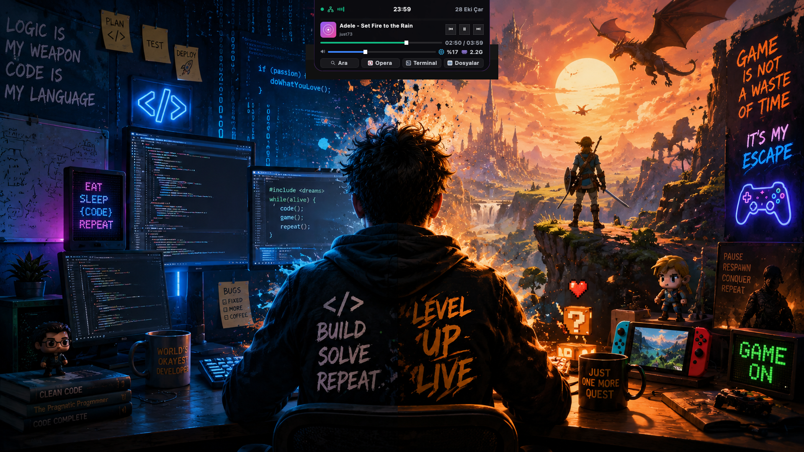
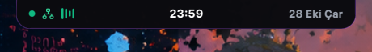
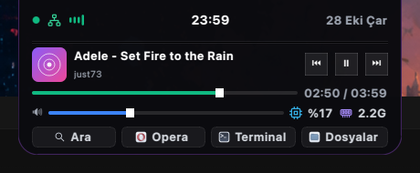
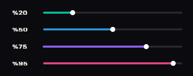

<div align="center">

# 🏝️ Dynamic Island for Desktop

### Ultra-lightweight, 60 FPS Apple-style Dynamic Island for Linux & Windows

[](https://python.org)
[](https://www.riverbankcomputing.com/software/pyqt/)
[](#installation)
[](#features)
[](LICENSE)

<br/>



<br/><br/>

[✨ Features](#-features) •
[📸 Showcase](#-showcase) •
[🚀 Installation](#-installation) •
[⚙️ Configuration](#-configuration) •
[📜 License](#-license)

</div>

---

## ✨ Features

- 🍎 **Authentic Apple Design:** Flush screen-top notch with smooth obsidian black background (`#0B0B0F`) and continuous bezier bottom curvature (`r=18px` to `r=22px`).
- ⚡ **Ultra-Lightweight & Fluid (60 FPS):** Pure PyQt5 native vector painting. Consumes **less than 40 MB of RAM** and 0% idle CPU (unlike 500MB+ Electron clones).
- 🎵 **Live Equalizer & Ambient Glow:** Animated 4-bar dynamic audio equalizer bounces when music plays; notch borders emit a vibrant neon violet ambient glow.
- 🎚️ **Interactive Seek Bar & Track Info:** Live track title, artist, vinyl album art thumbnail, and draggable seek slider with precise timestamps (`02:50 / 03:59`).
- 🪟 **Apple Glass Media Buttons:** Custom anti-aliased vector icons with an elevated, prominent frosted-glass Play/Pause hero button.
- 🌈 **Adaptive Volume Spectrum:** Real-time smooth RGB color gradient that shifts across the spectrum as volume changes:
  - `0% - 30%`: Calm Mint / Turquoise (`#10B981`)
  - `30% - 60%`: Electric Sky Blue (`#3B82F6`)
  - `60% - 80%`: Neon Cyberpunk Purple (`#A855F7`)
  - `80% - 100%`: Fiery Coral / Crimson (`#F43F5E`)
- 🔤 **Apple SF Pro Typography:** Pixel-perfect San Francisco Pro Display typography with seamless fallback to Inter.
- 📊 **Hardware Stats:** Microchip CPU utilization and RAM memory counters right in the drawer.
- 🌐 **Network Indicator:** Dynamic detection of active Wi-Fi, Ethernet (LAN), or disconnected state with tooltips.
- 🚀 **Quick App Launcher Dock:** Instant 1-click launch buttons for Search, Browser, Terminal, and File Manager.
- 🔀 **Cross-Platform Architecture:** Clean, modular backend system supporting both Linux (MPRIS + pactl) and Windows (GSMTC + pycaw).

---

## 📸 Showcase

### 1. Idle (Resting Notch)
Flushed smoothly against the top of your display with green status dot, live network icon, soundwave equalizer, centered SF Pro clock, and date:

<div align="center">
  
</div>

### 2. Expanded Drawer (Hover Mode)
Smooth cubic-bezier drop-down revealing album art, track details, seek bar, frosted glass media controls, adaptive volume slider, hardware metrics, and quick app launchers:

<div align="center">
  
</div>

### 3. Dynamic Reactive Volume Slider
Smooth real-time color morphing as volume increases:

<div align="center">
  
</div>

---

## 🚀 Installation

### 🐧 Linux (Ubuntu / Debian / XFCE / GNOME / KDE)

1. **Clone the repository:**
   ```bash
   git clone https://github.com/your-username/dynamic-island.git
   cd dynamic-island
   ```

2. **Install system dependencies & fonts:**
   ```bash
   # Debian / Ubuntu
   sudo apt update
   sudo apt install python3-pyqt5 python3-psutil python3-dbus pulseaudio-utils

   # Arch Linux
   sudo pacman -S python-pyqt5 python-psutil python-dbus libpulse
   ```

3. **Install Python requirements:**
   ```bash
   pip install -r requirements.txt
   ```

4. **Run immediately:**
   ```bash
   ./run.sh
   # or: python3 dynamic_island.py
   ```

5. **(Optional) Auto-start on boot via systemd:**
   ```bash
   mkdir -p ~/.config/systemd/user/
   cat << 'EOF' > ~/.config/systemd/user/dynamic-island.service
   [Unit]
   Description=Apple Dynamic Island for Desktop
   After=graphical-session.target

   [Service]
   Type=simple
   ExecStart=/usr/bin/python3 %h/dynamic-island/dynamic_island.py
   Restart=always
   RestartSec=3

   [Install]
   WantedBy=default.target
   EOF

   systemctl --user daemon-reload
   systemctl --user enable --now dynamic-island.service
   ```

---

### 🪟 Windows (Windows 10 / 11)

1. **Clone the repository:**
   ```powershell
   git clone https://github.com/your-username/dynamic-island.git
   cd dynamic-island
   ```

2. **Install requirements:**
   ```powershell
   pip install -r requirements.txt
   ```

3. **Run:**
   ```powershell
   .\run.bat
   # or: python dynamic_island.py
   ```

4. **(Optional) Build standalone `.exe`:**
   ```powershell
   pip install pyinstaller
   pyinstaller --onefile --noconsole --name="DynamicIsland" dynamic_island.py
   ```
   The portable executable will be generated inside the `dist/` directory!

---

## ⚙️ Architecture

The project utilizes an **Adapter / Backend Pattern** to cleanly decouple desktop UI rendering from OS-specific APIs:

```text
dynamic-island/
├── dynamic_island.py     # Main GUI widget (PyQt5, animations, styles, rendering)
├── run.sh                # Linux quick launcher
├── run.bat               # Windows quick launcher
├── requirements.txt      # Cross-platform dependency definitions
├── backends/
│   ├── __init__.py       # Factory: dynamically instantiates backend per platform
│   ├── base.py           # Abstract BaseBackend interface
│   ├── linux.py          # Linux implementation (D-Bus MPRIS, pactl, FreeDesktop)
│   └── windows.py        # Windows implementation (WinRT GSMTC, pycaw, Shell)
├── icons/                # Anti-aliased vector PNG assets
└── docs/
    └── screenshots/      # README showcase visual assets
```

---

## ⌨️ Controls & Shortcuts

| Action | Result |
| :--- | :--- |
| **Mouse Hover** | Automatically expands the drawer with cubic animation |
| **Mouse Leave** | Smoothly collapses back to compact idle notch after brief delay |
| **Seek Slider Drag** | Live seeks playback position in player (Spotify, Browser, VLC) |
| **Volume Slider Drag** | Real-time master volume change with reactive spectrum color shift |
| **Right-Click on Island** | Opens sleek dark context menu (Search, Toggle Panels, Exit) |

---

## 📜 License

This project is licensed under the **MIT License** - see the [LICENSE](LICENSE) file for details.

---

<div align="center">
  Crafted with ❤️ by Eray
</div>
